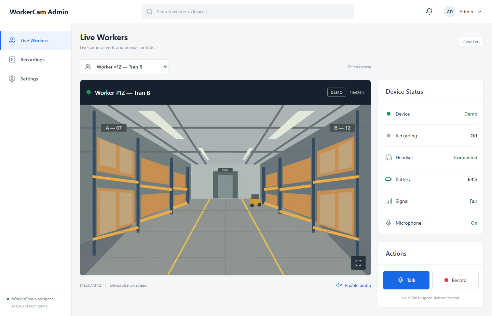
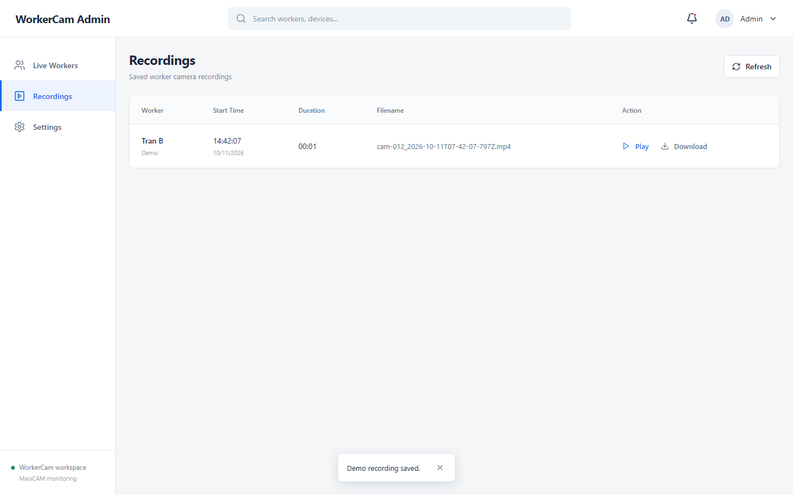

# WorkerCam — cài đặt trên Windows

WorkerCam hiển thị video MaixCAM, nghe microphone tai nghe Bluetooth, nói lại
qua nút **Talk** và lưu bản ghi trên máy tính.



*Ảnh minh họa dùng worker và video demo.*

## Chuẩn bị

- Windows có **Docker Desktop**, chạy **Linux containers** qua WSL 2.
- Cài **OpenSSH Client** trong Windows → Optional features.
- Máy tính có internet để tải image và thư viện khi build.
- MaixCAM đã có MaixPy, USB networking, SSH, Python 3, BlueZ/BlueALSA,
  FFmpeg, `arecord`, `aplay` và các công cụ SCO. Script cài ứng dụng WorkerCam;
  không flash firmware hay cài driver Windows.
- Camera dùng SSH `root` / `root`; script tự đăng nhập.
- Cáp USB **truyền dữ liệu** nối camera với máy tính trong suốt quá trình cài.
- Máy tính kết nối Wi-Fi cần dùng; chuẩn bị đúng tên mạng và mật khẩu.
- Bật tai nghe, lấy ra khỏi hộp. Nếu ghép lần đầu, bật chế độ pairing.
  MAC tai nghe của bộ hiện tại: `6C:16:29:7B:00:D4`.

Nếu chưa có Docker Desktop, làm theo [hướng dẫn Windows chính thức của Docker](https://docs.docker.com/desktop/setup/install/windows-install/).
Bật virtualization trong BIOS nếu Docker yêu cầu. Trong PowerShell quản trị,
có thể chuẩn bị WSL bằng `wsl --install --no-distribution`, khởi động lại nếu
được yêu cầu, sau đó chạy `wsl --update` và `wsl --set-default-version 2`.
Mở Docker Desktop và đợi engine sẵn sàng trước khi cài WorkerCam.

## Chạy fresh-install

**Chỉ có một script để chạy: `scripts/deploy.ps1`.** Dùng cùng lệnh này cho lần
cài đầu, cài lại, đổi Wi-Fi hoặc chuyển sang laptop khác.

1. Dừng ghi hình và đợi **Finalizing...** kết thúc.
2. Kết nối laptop vào Wi-Fi cần dùng, cắm USB camera và bật tai nghe.
3. Mở **PowerShell → Run as administrator**.
4. Chuyển đến thư mục dự án, ví dụ:

```powershell
Set-Location 'C:\WorkerCam'
```

Kiểm tra các công cụ đã sẵn sàng:

```powershell
docker info --format '{{.OSType}}'
docker compose version
ssh -V
```

Lệnh đầu phải in `linux`. Thay `YOUR_PC_WIFI_SSID` bằng đúng tên Wi-Fi laptop
đang kết nối, thay MAC nếu dùng tai nghe khác, rồi chạy:

```powershell
powershell.exe -NoProfile -ExecutionPolicy Bypass -Command "& .\scripts\deploy.ps1 -WifiSsid 'YOUR_PC_WIFI_SSID' -HeadsetMac '6C:16:29:7B:00:D4' -WifiPassword (Read-Host 'Wi-Fi password' -AsSecureString)"
```

Mật khẩu được hỏi là **mật khẩu Wi-Fi**, không phải SSH. Script tìm địa chỉ
USB/Wi-Fi, kết nối camera vào cùng SSID và lưu cấu hình mạng qua reboot.
`-ExecutionPolicy Bypass` chỉ áp dụng cho lần chạy này.

**Mỗi lần chạy đều cài mới toàn bộ ứng dụng:**

- Dừng **tất cả container Docker đang chạy** trên engine hiện tại.
- Xóa container WorkerCam, tạo lại cấu hình PC và góc camera.
- Dừng ứng dụng camera, ghi đè chương trình/cài đặt và reboot camera.
- Build image PC **không dùng cache**, khởi động và kiểm tra video/audio.
- Giữ các file video đã hoàn tất trong `recordings/`.

Không có backup ứng dụng hoặc rollback tự động. Bản ghi đang chạy có thể bị
gián đoạn. Container của dự án khác vẫn dừng sau khi cài xong.

Giữ cửa sổ PowerShell mở và USB kết nối. Build có thể mất vài phút. Chỉ coi
triển khai thành công khi có dòng:

```text
Deployment completed successfully.
```

Nếu lỗi, sửa nguyên nhân được in ra rồi chạy lại **chính lệnh trên**.
Lần chạy mới xử lý maintenance còn giữ từ lần cài thất bại.

## Mở và kiểm tra

Mở [http://127.0.0.1:8000](http://127.0.0.1:8000), đăng nhập **admin / admin**.
Chọn worker MaixCAM thật (**Worker #07**), nhấn **Ctrl+F5** nếu đang mở trang cũ.

- Kiểm tra video chuyển động và xoay camera.
- Nhấn **Enable audio**, kiểm tra nghe tiếng từ microphone tai nghe.
- Cho phép trình duyệt dùng microphone laptop, giữ **Talk** để nói lại.
- Chỉnh **Earbud microphone volume**, rồi nhấn **Apply microphone volume** để
  đổi tiếng mic gửi về laptop/bản ghi: 0 tắt tiếng, 100 giữ mức tăng +50%.
- Thử ghi ngắn, dừng, đợi hoàn tất rồi mở **Recordings** để xem/tải xuống.

Kiểm tra người thật nghe rõ cả hai chiều. Tai nghe SCO có chất lượng thoại
điện thoại; trạng thái kết nối không đủ để xác nhận nghe rõ.



Video nằm trong `recordings/`; sao lưu thư mục này khi chuyển laptop.
Camera gửi âm thanh microphone đến một PC; cài lại trên laptop mới sẽ đổi
đích nhận. Dừng WorkerCam trên laptop cũ trước khi chuyển.

## Khi có lỗi

| Hiện tượng | Cách xử lý |
| --- | --- |
| Docker chưa sẵn sàng | Mở Docker Desktop, chọn Linux containers và chờ engine chạy. |
| Yêu cầu administrator | Mở lại PowerShell bằng Run as administrator. |
| Không tìm thấy script | Chuyển vào thư mục chứa `scripts/deploy.ps1`. |
| Không thấy camera USB | Thử cáp dữ liệu/cổng USB khác; kiểm tra driver USB networking. |
| Sai SSID hoặc camera không vào Wi-Fi | Kết nối laptop đúng mạng, nhập đúng SSID/mật khẩu và giữ USB. |
| Docker network overlaps Wi-Fi address | Mạng Docker trùng subnet Wi-Fi. Đổi subnet của dự án được báo, hoặc gỡ mạng đó nếu không còn dùng; dừng container thôi chưa đủ. |
| Container unhealthy | Xem log bằng các lệnh bên dưới; sửa lỗi gốc rồi chạy lại fresh-install. |
| Video đen | Chọn worker thật, kiểm tra nguồn camera, nhấn Ctrl+F5. |
| Không nghe microphone tai nghe | Nhấn Enable audio, kiểm tra âm lượng PC và nguồn tai nghe; thử lại fresh-install nếu lỗi còn tồn tại. |
| Người đeo không nghe Talk | Cho phép microphone trình duyệt, kiểm tra đúng thiết bị đầu vào PC và giữ Talk khi nói. |

Ví dụ hotspot iPhone dùng `172.20.10.x` có thể trùng mạng Docker cũ
`172.20.0.0/16`. Script kiểm tra và báo tên mạng gây xung đột trước khi cài;
không tự xóa mạng của dự án khác.

Thu thập trạng thái và log để gửi người hỗ trợ:

```powershell
docker compose ps
docker compose logs --tail 80 server
```

Gửi lỗi và bước triển khai cuối cùng; không gửi mật khẩu.
Dùng WorkerCam trên mạng tin cậy. Login `admin` là giao diện thử nghiệm;
không mở API trực tiếp ra internet.

Tài liệu kỹ thuật: [triển khai](scripts/README.md),
[kiến trúc](docs/architecture.md), [ghi hình](docs/multistream-recording.md),
[frontend](frontend/README.md).
