# Current architecture, data pipelines and protocols

This describes the supported Docker/SCO configuration, updated on 2026-10-21
for native-bound camera streaming and PC display orientation. These source
changes await redeployment verification; earlier deployment evidence is in the
session logs. The diagram retains the earlier camera pixel-rotation path.
Physical audio/video latency and synchronization remain unmeasured for this path.

The selected defaults are **RTSP/TCP video-only monitoring, independent worker
microphone RTP/UDP return, SCO duplex talkback, and multistream MP4 recording**.
Here, `STREAM_MODE=video` describes the `/maix01` publisher, not the whole system:
microphone listening and recording audio use separate paths.

Editable diagram source: [architecture.mmd](architecture.mmd).

## Components and responsibilities

| Component | Responsibility | Implementation |
| --- | --- | --- |
| Worker headset | Microphone capture and speaker playback over Bluetooth SCO/eSCO; current setup uses narrowband CVSD, 8 kHz mono PCM at the ALSA boundary | BlueZ and BlueALSA on MaixCAM |
| Camera video application | Defaults to native-bound 768×432 NV21 at 20fps, hardware encodes and serves H.264 on `/live`; optional Python fallback | `maix/rtsp_av.py`, `maix/video_rtsp.py`, `maix/rtsp_app.yaml` |
| Camera Bluetooth service | Selected-headset connection, BlueALSA routing, SCO preparation/recovery and token-free control API | `maix/bluetooth_audio.py`, `maix/bluetooth_control.py` |
| Camera microphone sender | Captures headset PCM and sends G.711 mu-law RTP to the PC | `maix/headset_mic_stream.py` |
| Camera talkback receiver | Validates TB3 datagrams, reorders bounded audio and plays through ALSA `bt_output` | `maix/talkback_receiver.py`, deployed copy of `pc/talkback_protocol.py` |
| PC supervisor | Starts MediaMTX, the video publisher, independent return receiver and operator server | `app.py` |
| MediaMTX | Three independent media paths: `/maix01`, `/headsetmic`, `/talkback`; bridges RTSP and browser WebRTC | `mediamtx.yml` |
| PC operator backend | Serves UI/API/files, relays camera control, manages talkback and recording | `pc/operator_server.py`, `pc/bluetooth_client.py`, `pc/talkback.py` |
| Browser UI | React/TypeScript interface; independent WHEP playback peers for video and worker sound; microphone WHIP publication while Talk is held | `frontend/src/main.tsx`, `media.ts`, `data.ts` |
| PC recorder | Copies video and decodes worker/operator audio independently; produces MP4 on stop | `pc/multistream_recording.py` |

The PC processes share one Linux Docker container, rather than separate Compose
services. The image contains Python, FFmpeg, MediaMTX and the compiled UI. Node
builds the UI in a separate image build stage. Camera programs run directly on
MaixCAM. The browser runs on the Windows PC.

## Live data pipelines

### 1. Camera to operator video

`Camera → native-bound hardware H.264 RTSP/TCP /live → PC FFmpeg → MediaMTX /maix01 → browser`

FFmpeg reads `rtsp://<MAIX_IP>:8554/live` with RTP interleaved over RTSP/TCP,
maps only video, and copies H.264 without re-encoding. It publishes to local
`rtsp://127.0.0.1:8554/maix01`, also over TCP in this configuration. The browser
negotiates reception at `http://127.0.0.1:8889/maix01/whep` and receives H.264
using WebRTC over UDP. TCP is used on the RTSP legs; the browser media leg is UDP.

PC `CAMERA_BASE_ROTATION=0|90|180|270` (default `0`) adds a fixed mounting
offset to the manager selection: `(base_rotation + manager_rotation) % 360`,
counter-clockwise. Compose passes this setting from `.env`; both Python entry
points also accept `--camera-base-rotation`. The API keeps `rotation` as the
saved manager selection and returns `effective_rotation` for rendering. The
browser uses the existing canvas quarter-turn renderer (CSS at 0/180). Both
recorders copy the source H.264 and write the effective MP4 display matrix;
existing recordings and the saved manager selection are unchanged. Rotation
is locked during recording/finalization. See [orientation configuration](rtsp-transport.md#pc-display-orientation).

### 2. Worker headset microphone to operator listening

`Headset → Bluetooth SCO → BlueALSA/arecord → camera FFmpeg → RTP/UDP → PC FFmpeg → /headsetmic → browser`

Capture is signed 16-bit little-endian PCM, 8 kHz, mono. The camera requests
20 ms capture periods and an 80 ms ALSA buffer. It bounds backlog before feeding
FFmpeg, which encodes G.711 mu-law (PCMU), grouping 160 samples per 20 ms frame.
The nominal RTP packet is 172 bytes: a 12-byte RTP header plus 160 audio bytes.

The camera sends directly to `<PC-IP>:8004` over UDP. This camera-to-PC leg does
not use RTSP signaling. The PC creates a local SDP description, receives RTP,
and copies PCMU into MediaMTX `/headsetmic` over local RTSP/TCP. The browser uses
a separate `/headsetmic/whep` connection to receive G.711 audio. Playback needs
the user's Enable audio action. Microphone-return retry/backoff is independent
of the video publisher, so return loss does not intentionally stop video.

### 3. Operator microphone to worker headset

`Browser microphone → WebRTC/WHIP → MediaMTX /talkback → PC FFmpeg → PCM/TB3 UDP → MaixCAM ALSA → headset`

While Talk is held, the browser captures an audio track and submits an SDP offer
through `POST /api/talkback/offer`. The backend proxies signaling to MediaMTX
`/talkback/whip`. Actual audio travels by WebRTC, normally negotiated as Opus;
HTTP carries signaling rather than batches of microphone audio.

PC FFmpeg reads `/talkback` using local RTSP/TCP in the selected configuration
and decodes/resamples to 8 kHz mono PCM16. A paced sender emits up to 320 PCM
bytes every 20 ms to camera UDP port 9002. It retains at most three queued
frames (60 ms) and drops frames older than 120 ms.

The camera validates TB3 framing and uses a 40 ms reorder window, capped at
six frames, dropping audio more than 120 ms late. It writes PCM to `aplay` on
`bt_output`; SCO playback requests a 20 ms period and 80 ms buffer. Silence is
paced through temporary gaps. These are buffer policies, not measured physical
end-to-end latency.

Releasing Talk stops the browser track/peer, deletes the WHIP session and ends
the relay. Stop requests carry a session identifier so an old release cannot
stop a newer session. Blur/navigation and media failure also trigger cleanup.
MediaMTX rejects a second publisher on `/talkback`.

### 4. Control and status

The browser calls HTTP JSON APIs on port 8000 for Bluetooth status/selection,
diagnostics and recording lifecycle. The PC proxies headset operations to
`http://<MAIX_IP>:8765/bluetooth/{status,scan,select,clock}` without a shared-token header. Status and clock responses identify `talkback_protocol: TB3`.
Before a talk session, the PC requires TB3 and samples the
camera clock and anchors packet timestamps to PC monotonic time, retaining the
two-second TB3 freshness check without changing either device's system clock.

## Protocol and port map

| Boundary | Protocol / media | Destination and scope |
| --- | --- | --- |
| Headset ↔ camera | Bluetooth HFP/SCO/eSCO, narrowband audio; BlueALSA PCM locally | Bluetooth radio; no IP port |
| Camera video → PC reader | RTSP control plus interleaved RTP/RTCP over TCP; H.264 | Camera TCP 8554, `/live` |
| Camera microphone → PC receiver | RTP/UDP, PCMU 8 kHz mono, static payload type 0; accompanying RTCP port | PC UDP 8004/8005, published on host interfaces |
| PC publishers/readers ↔ MediaMTX | RTSP/TCP with interleaved media for the selected pipeline | Container TCP 8554, `/maix01`, `/headsetmic`, `/talkback`; host publication on loopback only |
| Browser playback signaling | WHEP HTTP with SDP | PC loopback TCP 8889, `/maix01/whep` and `/headsetmic/whep` |
| Browser microphone signaling | Operator HTTP SDP proxy → MediaMTX WHIP | PC loopback TCP 8000 → container TCP 8889, `/talkback/whip` |
| Browser ↔ MediaMTX media | WebRTC: ICE/STUN connectivity, DTLS key negotiation, SRTP/SRTCP over UDP | PC loopback UDP 8189; browser ephemeral port |
| PC → camera talkback | Custom token-free TB3 UDP, PCM16 little-endian 8 kHz mono | Camera UDP 9002; PC ephemeral source port |
| PC → camera control | Token-free HTTP JSON | Camera TCP 8765 |
| Browser → operator | HTTP UI, JSON API, recording playback/download | PC loopback TCP 8000 |
| Installer → camera | Windows OpenSSH SSH/SCP, pinned host key | Camera SSH port, normally TCP 22; deployment only |

Compose publishes web/RTSP/WebRTC ports on `127.0.0.1` for a browser on this PC;
UDP 8004/8005 accepts the camera return through Docker's published ports. Camera
9002/8765 are camera listeners, not PC port mappings. MediaMTX's configured
8002/8003 UDP RTSP ports belong to optional UDP RTSP operation and are not host
publications in this Compose setup. No WebRTC TCP listener is configured.

### TB3 wire format

Each datagram is `24-byte header + 0..320-byte PCM payload`.
Maximum size is 344 bytes; a stop packet has no PCM.

| Field | Size | Encoding |
| --- | --- | --- |
| Magic | 3 bytes | ASCII `TB3` |
| Stop flag | 1 byte | 0 for audio, 1 for stop |
| Session | 8 bytes | Unsigned integer, network byte order |
| Sequence | 4 bytes | Unsigned integer, network byte order |
| Timestamp | 8 bytes | UTC milliseconds, network byte order, calibrated to camera time |
| Audio | Up to 320 bytes | Even-length PCM16 little-endian, mono, 8 kHz |

The decoder rejects invalid format and timestamps more than
two seconds from camera time. The jitter buffer rejects duplicate/played
sequence numbers and mismatched sessions. TB3 rejects TB1/TB2 and provides no sender authentication, tamper detection or
encryption. Update PC and camera together; incompatible calibration fails clearly. Browser media uses WebRTC encryption; camera RTSP/RTP and control
HTTP use the trusted local network. The prototype frontend login is a browser
gate, not server API authorization.

## Recording and stored data

Multistream recording reads `/maix01`, `/headsetmic` and `/talkback` independently
over local RTSP/TCP. It copies H.264 into staged Matroska video and decodes each
audio source to 48 kHz mono PCM16. Reconnecting audio readers feed bounded queues;
a PC monotonic coordinator writes one 960-sample block every 20 ms, supplying
silence for absent worker/operator audio. Talk sessions join the same recording
timeline; an absent microphone does not terminate the video recording.

On Stop, capture ends and asynchronous FFmpeg finalization produces:

| MP4 stream | Encoding / behavior |
| --- | --- |
| Video | Original H.264 dimensions and slice bytes preserved; MP4 display rotation matches the manager's live orientation |
| Mixed conversation | 48 kHz mono AAC, 96 kbit/s; default audio track |
| Worker microphone | 48 kHz mono AAC, 96 kbit/s |
| Operator microphone | 48 kHz mono AAC, 96 kbit/s |

The mix weights voices equally and limits peaks. Output is written as a partial
MP4 and atomically renamed when complete. Successful finalization removes staged
media; errors retain it for recovery. Video loss ends capture and attempts
finalization; audio loss inserts silence. Recording controls and safe deployment
scripts block a new recording/shutdown/update while finalization is active.

Video packet arrival is mapped to the recording origin through a fixed PC
wall-clock/monotonic bridge; decoded audio arrival drives the PCM timeline.
These distinct arrival points do not establish physical A/V synchronization.
See [recording details and recovery](multistream-recording.md) for timing limits.

Saved MP4s, metadata, manifests and recorder logs live in the host `recordings/`
bind mount. No application token is mounted. Browser
worker/preferences/demo metadata lives in IndexedDB; login state lives in
sessionStorage. There is no required server database in the current Compose
stack. Worker #12 is synthetic demo content; Worker #07 uses the physical camera.

## Startup and preserved configuration

`run_all.ps1` coordinates startup; `deploy_pc.ps1` builds/starts the single Compose
service and verifies health plus Windows HTTP access. `deploy_maix.ps1` installs
camera programs/settings with backups. `stop_docker_pc.ps1` safely stops the PC
service after recording/finalization completes.

On MaixCAM, the app launcher manages video. The boot template prepares and verifies
SCO MTU 120 after controller power-up, before starting Bluetooth/audio clients;
then it starts the connector/control service, duplex receiver and microphone
sender. SCO permits capture to continue while operator speech plays.

The `.env`/Compose selection is TCP + video + multistream; camera deployment
defaults to SCO. Explicit A2DP fallback pauses capture using a local pause/ack
handshake while talkback plays. Legacy recording saves video only in the selected
video monitoring mode. Direct `python app.py` without the deployment environment
still defaults to UDP/combined media; it does not automatically load `.env`.
The rotated camera publisher serves RTSP/TCP only. Use the Docker defaults or
explicit `--rtsp-transport tcp --stream-mode video`; the older UDP/combined
defaults require the earlier camera publisher.

Source of truth: [Compose](../compose.yaml), [supervisor](../app.py),
[MediaMTX configuration](../mediamtx.yml), [camera boot template](../maix/background_services.rc.local),
the implementation files above and the [customer README](../README.md).
