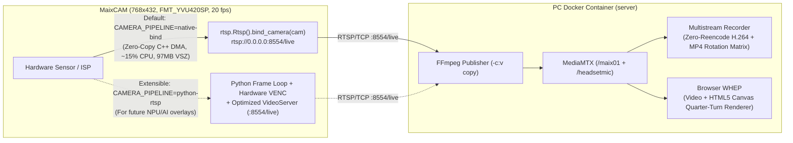

# Design

## Context

See `proposal.md` for motivation and scope, and `specs/camera-media-efficiency/spec.md` for the behavioral contract.

Controlled live benchmarks executed directly on MaixCAM (`10.172.16.1`) at `768×432` while streaming to the PC (`192.168.1.4`) measured five streaming implementations:

| Mode on MaixCAM (`768×432`) | Video Process `%CPU` | System `%idle` | Disk I/O (`%io`) | Video `VSZ` | Notes |
|---|---:|---:|---:|---:|---|
| 1. Current `maix/rtsp_av.py` (`rotate_nv21` + Python `video_rtsp.py`) | **53% – 81%** | **0% – 1%** | **10% – 28%** | **112–134 MB** | `cv2`+`numpy` exceeds 128 MB RAM alongside `ffmpeg` (33 MB), causing eMMC page-fault thrashing |
| 2. `http_stream.py` (`http.JpegStreamer`, `cam.read()` loop) | **50% – 53%** (~80% w/ browser) | **20% – 33%** | **0%** | **97 MB** | Python loop + RGB/MJPEG CPU encoding; incompatible with PC `-c:v copy` H.264 recorder |
| 3. Python `video.Encoder` + `video_rtsp.py` (no `rotate_nv21`) | **40% – 46%** | **36% – 46%** | **0%** | **99 MB** | Avoids `cv2`/`numpy` swap, but still runs `cam.read()` + RTP packetizing in Python |
| 4. Native C++ `rtsp.Rtsp().bind_camera` (`25 fps`) | **29% – 30%** | **50%** | **0%** | **97 MB** | Hardware ISP → Hardware H.264 VENC → C++ RTSP `/live` |
| 5. **Native C++ `rtsp.Rtsp().bind_camera` (`20 fps`)** | **9% – 23%** | **58% – 63%** | **0%** | **97 MB** | Same C++ hardware DMA pipeline at 20 fps; leaves ~60% CPU free |

## Goals / Non-Goals

**Goals:**
- Drop MaixCAM video CPU usage from 53%–81% (`0%–1% idle`, `28% io`) to **9%–23% (`58%–63% idle`, `0% io`)** by defaulting `maix/rtsp_av.py` to hardware-bound C++ `rtsp.Rtsp().bind_camera(cam)` at `768×432, 20 fps`.
- Keep the architecture **100% compatible with the existing PC stack** (`rtsp://<MAIX_IP>:8554/live` → PC FFmpeg `-c:v copy` → MediaMTX `/maix01` → Browser WHEP `<canvas>` + 4-track multistream MP4 recorder) and **extensible** for future camera-side Python/NPU features via `CAMERA_PIPELINE=native-bind|python-rtsp`.
- Free an additional **33 MB VSZ (25% of MaixCAM RAM)** and ~4% CPU by replacing the `ffmpeg` child process in `headset_mic_stream.py --rtp-port 8004` with an in-process RFC 3550 G.711 PCMU UDP sender.
- Reclaim ~6% CPU from `klogd`/`syslogd` by capping kernel `printk` verbosity and disabling `wlan0` power saving at boot.

**Non-Goals:**
- Switching to MJPEG (`http_stream.py`), which consumes 80% CPU on MaixCAM and breaks zero-reencode H.264 MP4 recording on the PC.
- Modifying the TB3 talkback UDP protocol (`9002`) or Bluetooth eSCO (`MTU 120:4`) boot sequence.

## Decisions

### 1. Extensible Dual-Mode Camera Pipeline (`CAMERA_PIPELINE=native-bind|python-rtsp`) in `maix/rtsp_av.py`

- **`native-bind` (Default):**
  - `cam = camera.Camera(width, height, image.Format.FMT_YVU420SP, fps=fps)` (default `768×432`, `fps=20`).
  - `server = rtsp.Rtsp(port=8554)` → `server.bind_camera(cam)` → `server.start()`.
  - Main thread loops `while not app.need_exit(): time.sleep(1)`.
  - Never imports `cv2`, `numpy`, or `video_rtsp`, saving 37 MB of RAM and eliminating all flash I/O thrashing (`0% io`).
  - Exposes the exact same `rtsp://<MAIX_IP>:8554/live` endpoint so `app.py`, `pc/check_camera_udp.py`, and `MediaMTX` require zero transport changes.
- **`python-rtsp` (Extensible Fallback for Custom Python/NPU Processing):**
  - Selected via `--pipeline python-rtsp` or `CAMERA_PIPELINE=python-rtsp` in `/root/workercam.env`.
  - Uses the optimized `maix/video_rtsp.py` (`bytes.find` zero-copy `split_nals`, pre-allocated `rotate_nv21` destination buffers, and blocking `self.frames.get(timeout=0.2)` client dispatch instead of 100 Hz `select` polling) and supports a pluggable `frame_hook(img)` callback for future MaixPy NPU/AI detectors.

### 2. PC-Side Zero-Reencode Orientation (`CAMERA_BASE_ROTATION` + Manager Selection)

- Because `native-bind` streams `768×432` directly from hardware without camera-side software rotation:
  - Any 90°/180°/270° rotation selected by the manager in the UI (`/api/camera/view`) is already rendered on the browser's HTML5 `<canvas>` (`paintVideoFrames` in `frontend/src/media.ts`) and written into the MP4 display matrix (`pc/recording.py`, `pc/multistream_recorder.py`) without re-encoding video.
  - Add an optional `CAMERA_BASE_ROTATION` (`0`, `90`, `180`, `270`, default `0`) in `app.py` / `pc/operator_server.py` so if a physical camera unit is mounted sideways, the PC can apply a fixed baseline offset `(base_rotation + manager_rotation) % 360` transparently while keeping MaixCAM in zero-copy `native-bind` mode.

### 3. In-Process RFC 3550 G.711 PCMU RTP/UDP Sender in `maix/headset_mic_stream.py`

- When `--rtp-port` is configured (default `8004`):
  - Replace the `ffmpeg` child process (`PID 626`, `33 MB VSZ`, `3% CPU`) with an in-process `RtpPcmUlawSender` in `maix/headset_mic_stream.py`.
  - Convert each 20 ms (`320-byte`, 160-sample) 8 kHz S16LE PCM frame to 160 bytes of G.711 µ-law (`audioop.lin2ulaw(frame, 2)`, with a precomputed 65536-entry `bytes` lookup fallback for Python 3.13+), prepend the 12-byte RFC 3550 RTP header (`version=2`, `payload_type=0` PCMU, `seq`, `timestamp += 160`, `ssrc`), and send the 172-byte UDP datagram directly to `(target, rtp_port)`.
  - Retain the `ffmpeg` RTSP subprocess path when `--rtp-port` is omitted.

### 4. Boot-Time Kernel Printk & Wi-Fi Power-Save Tuning in `maix/background_services.rc.local`

- Add best-effort boot tuning before launching background processes:
  - `dmesg -n 4 2>/dev/null || echo 4 >/proc/sys/kernel/printk 2>/dev/null || true`
  - `iw dev wlan0 set power_save off 2>/dev/null || iwconfig wlan0 power off 2>/dev/null || true`

## Risks / Trade-offs

- **Hardware `rtsp.Rtsp()` does not support arbitrary software pixel mutation** → Mitigated by keeping `CAMERA_PIPELINE=python-rtsp` as a first-class configurable mode in `maix/rtsp_av.py` and handling orientation on the PC at zero re-encode cost.
- **Python 3.13+ removal of `audioop`** → Mitigated by including a pure-Python 16-bit PCM to µ-law lookup table fallback when `audioop` is absent.

## Migration Plan

1. Implement `CAMERA_PIPELINE=native-bind|python-rtsp` in `maix/rtsp_av.py`, optimize `maix/video_rtsp.py`, add `CAMERA_BASE_ROTATION` in `app.py`/`pc/operator_server.py`, implement `RtpPcmUlawSender` in `maix/headset_mic_stream.py`, and add boot tuning in `maix/background_services.rc.local`.
2. Run all unit, frontend, and Docker Compose checks locally.
3. When authorized, deploy via `scripts/deploy.ps1 -Force` and verify MaixCAM `top` shows ~60% idle CPU, `0% io`, no `ffmpeg` child process under `headset_mic_stream.py`, and continuous 60-second browser video + audio + recording.
